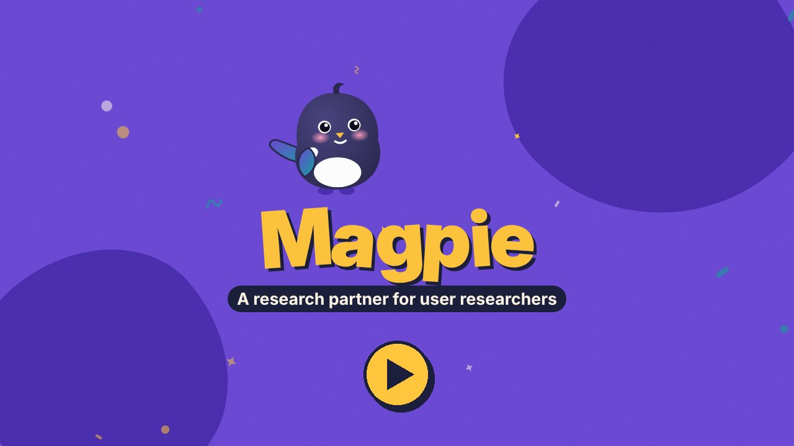

# Magpie

Magpie is a free, open-source research partner for user researchers. You
add it to an AI tool you already use, such as Claude, ChatGPT, Gemini or
Copilot. It works with you on a study from the first question, "Do we
already know this?", to a report your product manager, designer and
engineer can act on. It takes on much of the drafting and checking, so
you can spend more of your time on the thinking only you can do. It's
built for researchers and research leads, and for PMs and designers
doing their own research. See
[what makes Magpie different](#what-makes-magpie-different).

**Watch the intro video** (about 3 minutes, with voice-over and
captions) to see what
Magpie does and how to get started:

<a href="https://youtu.be/2tVyQar-_vo"></a>

Made by Kirsten Hosic.

Why a magpie: it collects the shiny bits of evidence that already exist,
then helps you figure out which ones matter for the decision in front of
you.

**On this page**

- **[What makes Magpie different](#what-makes-magpie-different)**
- **[Before you rely on Magpie](#before-you-rely-on-magpie)**
- **[Get started](#get-started)** (start here)
  - Set up Magpie in your tool: [Claude Code](#claude-code) ·
    [Claude.ai](#claudeai) · [ChatGPT](#chatgpt) · [Gemini](#gemini) ·
    [Copilot](#copilot) ·
    [Codex, OpenCode or Gemini CLI](#other-agent-tools-codex-opencode-gemini-cli) ·
    [another AI tool](#any-other-ai-tool)
- **[How Magpie works](#how-magpie-works)**
- **[How Magpie helps your product team](#how-magpie-helps-your-product-team)**

Reference:

- [What you get](#what-you-get)
- [The stages](#the-stages)
- [Methods it covers](#methods-it-covers)
- [Shortcuts you can type](#shortcuts-you-can-type)
- [Pick up where you left off](#pick-up-where-you-left-off)
- [Can I trust it?](#can-i-trust-it)
- [Privacy, security and personal details](#privacy-security-and-personal-details)
- [When something goes wrong](#when-something-goes-wrong)
- [Keep Magpie up to date](#keep-magpie-up-to-date)
- [For contributors](#for-contributors)
- [Thanks to](#thanks-to)
- [Credit and license](#credit-and-license)

## What makes Magpie different

- **It finds what a quick AI summary misses.** Ask an AI for themes and
  you often get what you could have guessed: "users want it faster."
  Magpie reads every line, notes why people feel the way they do, and
  keeps the people who disagree and the strongest quotes in view.
  [How analysis works](core/stages/07-analyze.md)
- **It asks for your view before it gives its own.** An AI's first
  answer can steer your thinking. At five key steps, such as naming the
  patterns you saw in your sessions, you go first. You also decide
  whether to keep, change or drop each theme before any findings are
  written. [Where you go first](#your-turn-where-you-go-first)
- **It shows where every finding came from.** Each finding names the
  participants and quotes behind it, so you can check it in seconds.
  A second, separate AI reviews the findings before you share them.
  [Can I trust it?](#can-i-trust-it)
- **It stays with you for the whole study.** You don't need a different
  prompt for each task. Magpie keeps a running record of your study, so
  your analysis still ties back to the decision the study was for. Start
  at any stage, even with finished transcripts.
  [The stages](#the-stages)
- **It tells you how sure it is.** Each finding says how strong the
  evidence is, how much it matters, and whether it's enough for the
  decision your team is making. [What you get](#what-you-get)
- **It helps you show what your research changed.** At the end of a
  study, it drafts a row for your impact log. Later, it helps you
  gather the evidence. [What you get](#what-you-get)
- **It's free and works in the AI tool you already use.** Claude,
  ChatGPT, Gemini or Copilot. Magpie itself sends nothing anywhere.
  [Privacy and security](#privacy-security-and-personal-details)

**An example.** This one is made up, to show the difference. Ten people
talked about setting up bills in a budgeting app.

- *A quick AI summary:* "Users want bill setup to be faster (8 of 10)."
- *Magpie:* "8 of 10 said setting up a bill takes too long. For two of
  them it goes further. P4 has stopped adding small bills, because the
  app keeps asking for proof of the amount. P9 keeps a paper list,
  because a setup once vanished halfway through. P7 and P10 found setup
  fine."

The first tells the team to make a form faster. The second shows people
working around the app because they don't trust it.

## Before you rely on Magpie

**Work in progress.** Magpie has been tested only in Claude Code so far,
and it improves often. Read [Can I trust it?](#can-i-trust-it) before
you rely on it, and [check for updates](#keep-magpie-up-to-date) every
week or two.

**Free and "as is".** Magpie is free and comes "as is", with no
warranty and no support (see the [license](LICENSE)). You're responsible
for what you share with your AI tool, for checking Magpie's work before
you use or share it, and for following your organization's rules.
Magpie's suggestions on methods, statistics, ethics and consent are a
starting point for your own judgment. They aren't legal, privacy or
compliance advice.

## Get started

Three steps: pick your AI tool, set Magpie up, and start your first
study. If you'd like to know how Magpie works first, read
[How Magpie works](#how-magpie-works).

**Stuck on a step?** Ask the AI tool you're using, for example: *"How do
I install a skill from a zip file?"* or *"How do I open a folder here?"*
Each tool works a little differently, and it can walk you through its
own way.

### Pick your AI tool

Magpie works best in an **agent tool**, such as Claude Code, OpenAI
Codex, Gemini CLI or OpenCode. There it can run its own quote and count
checks and start its independent checker agents (a second AI that
checks Magpie's drafts) for you. A **chat**,
such as Claude.ai, ChatGPT, Gemini or Copilot, is a good way to try it
out. [Compare the two](#which-kind-of-ai-tool-to-use).

### Using Magpie at work

Anything you share with Magpie goes to the AI tool it runs in. So for
work projects:

- **Use an approved tool.** Use Magpie only in an AI tool your employer
  has approved.
- **Follow your data rules.** That includes your organization's rules on
  participant data, transcripts, recordings and anything your company
  treats as internal.
- **Open only the study folder.** An agent tool can open files on your
  computer, so keep in that folder only what you mean to share.

If you aren't sure what's allowed, ask your manager or your privacy or
security team before you start.

For what Magpie does with personal details, and what's up to your AI
tool, see [Privacy, security and personal details](#privacy-security-and-personal-details).

### Set up Magpie

Jump to the steps for your tool:

- [Claude Code](#claude-code)
- [Codex, OpenCode or Gemini CLI](#other-agent-tools-codex-opencode-gemini-cli)
- [Claude.ai](#claudeai)
- [ChatGPT](#chatgpt)
- [Gemini](#gemini)
- [Copilot](#copilot)
- [GitHub Copilot in VS Code](#github-copilot-in-vs-code)
- [Any other AI tool](#any-other-ai-tool)

When you're done, [check that it worked](#check-that-it-worked).

First, download the file for your tool:

| Your tool | Download |
| --- | --- |
| [Gemini](#gemini) | **[magpie-gemini.zip](https://github.com/kirstenhosic/user-research-assistant/releases/latest/download/magpie-gemini.zip)** |
| [Copilot](#copilot) | **[magpie-copilot.zip](https://github.com/kirstenhosic/user-research-assistant/releases/latest/download/magpie-copilot.zip)** |
| Any other tool, including [Claude Code](#claude-code), [Claude.ai](#claudeai) and [ChatGPT](#chatgpt) | **[magpie.zip](https://github.com/kirstenhosic/user-research-assistant/releases/latest/download/magpie.zip)** |

Each one holds everything Magpie needs for that tool.

#### Claude Code

You need the Claude Code desktop app or the command-line tool (it runs
in a Terminal window). Anthropic's
[Claude Code overview](https://code.claude.com/docs/en/overview) shows
how to get it (checked October 31, 2026).

1. Download `magpie.zip` and open Claude Code.
2. Ask Claude Code to install it, for example: *"Unzip
   ~/Downloads/magpie.zip into ~/.claude/skills/magpie/"*. Magpie then
   works in all your projects on this computer. (`~` is short for your
   home folder.)
3. Start a conversation and ask for help with a study, or say "magpie".

To share Magpie with a team, put it in a shared project's
`.claude/skills/magpie/` folder instead. Folders that start with a dot
are hidden: on a Mac, press Cmd+Shift+. in Finder to show them; on
Windows, turn on **Hidden items** in File Explorer's **View** menu. More
in Claude Code's [skills docs](https://code.claude.com/docs/en/skills)
(checked October 28, 2026).

#### Other agent tools (Codex, OpenCode, Gemini CLI)

These tools can load Magpie the same way Claude Code does, but **Magpie
hasn't been tested in them yet.** Ask your tool to install it, for
example: *"Install the skill in ~/Downloads/magpie.zip so it works in all
my projects."* It knows where its own skills go. Then start a
conversation and ask for help with a study, or say "magpie". If
something doesn't work, please
[open an issue](https://github.com/kirstenhosic/user-research-assistant/issues).

#### Claude.ai

You need a Claude.ai account with Projects.

1. Create a new Project.
2. Unzip `magpie.zip` and add all the files whose names end in `.md` to
   the project's knowledge.
3. Paste the contents of `operating.md` (Magpie's main instructions) into
   the project's instructions.
4. Start a chat in the project and describe your study.

#### ChatGPT

ChatGPT adds Magpie as a skill. OpenAI's help center lists skills for
Business, Enterprise, Healthcare and Edu workspaces (checked October 26,
2026); on a personal plan, try the steps anyway.

1. In the sidebar, open **Plugins**, then the **Skills** tab.
2. Choose **Create** > **Upload from your computer** and upload
   `magpie.zip`.
3. If ChatGPT says **Needs Review**, read what it flags. The only code in
   the package is eight small scripts that check quotes, counts,
   wording and personal details and make Word and Excel files; none of them connects to the
   internet.
4. Install it, then start a chat and type `@magpie`, or just describe
   your study.

**If there's no Skills page:** unzip `magpie.zip`, create a Project,
paste `operating.md` as the project instructions, and add the other `.md`
files as project files.

#### Gemini

You need a Google account signed in to Gemini, with Keep Activity turned
on.

1. Go to gemini.google.com. In the sidebar, open **Customize** (it may be
   under **More**), then **Skills**.
2. Choose **Create** > **Upload** and pick
   **[magpie-gemini.zip](https://github.com/kirstenhosic/user-research-assistant/releases/latest/download/magpie-gemini.zip)**,
   not `magpie.zip`. Gemini won't load a skill that contains code, and
   this copy leaves the code checks out. Magpie does those checks by hand
   instead.
3. Check what Gemini shows, then choose **Create**.
4. In a chat, type `/magpie`, or just describe your study.

Uploading works in the web app and the Mac app, not the phone apps.

#### Copilot

Use **Cowork** in Microsoft 365 Copilot. At work you need a Copilot
license, and your admin has to turn Cowork on. On a personal Microsoft
account you need Microsoft 365 Premium or Pro, in the US or Canada.
Personal, Family and the free Copilot app don't have Cowork.

1. Download
   **[magpie-copilot.zip](https://github.com/kirstenhosic/user-research-assistant/releases/latest/download/magpie-copilot.zip)**,
   not `magpie.zip`. It has its files combined to fit Copilot's file limit.
2. In Cowork, open **Customize** > **Skills**, choose the arrow next to
   **Add**, then **Upload skill**, and pick `magpie-copilot.zip`.
3. When it appears under **Your skills**, start a chat and describe your
   study.

More detail is in the [Copilot setup notes](adapters/copilot/README.md).

#### GitHub Copilot in VS Code

This is a different Copilot: the one inside the VS Code editor, used in
agent mode. Use **magpie.zip**. Unzip it into a folder named `magpie`
where Copilot looks for skills. Ask Copilot: *"Where do I put an agent
skill so you can use it?"*

Three things make a big difference here:

- **Pick a model.** The model picker can be set to **Auto**. In one
  study's logs, Auto used different models on different turns, some of
  them small and fast. Pick one strong model for the whole study.
- **Keep one copy of Magpie.** Copilot may find skills in more than one
  folder, and an old copy can load without telling you. Ask Copilot:
  *"Which skills can you see, and which folder is each one in?"* Remove
  any older copy.
- **Check that the reviews ran.** At some steps, Magpie has a separate
  reviewer check its draft before you see it. Its reply says when the
  review ran. If it gives you text to paste into a fresh chat instead,
  do that before you rely on the draft.

#### Any other AI tool

Upload `magpie.zip` if the tool takes skills. If it has projects or
knowledge files instead, set it up like Claude.ai: paste `operating.md`
as the instructions and add the other `.md` files.

#### Check that it worked

Start a conversation and ask for help with a study. You'll know Magpie
is working when the first reply starts *"Magpie is on for this
conversation"* and every reply ends with a status line, such as *Magpie
is still on. We're at stage 5 of 8: Plan the study.* If not, see
[When something goes wrong](#when-something-goes-wrong).

### Get more from Magpie (optional)

Magpie works fine without any of this. These are small changes to your
AI tool's settings that can make its answers more careful. Try one, or
none. You can undo each of them any time.

Menus in AI tools move often. The steps below were checked on each
company's help pages on November 3, 2026. If you can't find a setting,
ask your AI tool where it is. It can usually tell you.

#### 1. Ask your AI to say when it isn't sure

AI tools can sound just as confident when they're wrong as when they're
right. You can give your tool standing instructions, which are notes it
reads before every chat. Magpie already follows rules like these. Adding
them to your tool helps in your other chats too.

Copy this and paste it where your tool keeps its instructions:

```
Be accurate before you are helpful. A confident wrong answer is worse
than no answer.
- If you are not sure about something, say so. Never present a guess
  as a fact.
- Do not make up sources, authors, links or book titles. If you can't
  name a real source, say so.
- Only say a real person said something if you are sure they did.
- If a number doesn't come from what I gave you, say how sure you are
  and suggest I check it. Counts from my own data don't need this.
- Tell me when something may have changed since your information was
  last updated.
- If something is unclear or missing, ask me instead of guessing.
```

- **Claude.ai:** select your initials in the lower left, then
  **Settings** > **Your Claude** > **Instructions**. (In some accounts
  it's **Settings** > **Account** > **Instructions for Claude**.)
- **Gemini:** open the menu, then **Settings & help** > **Personal
  Intelligence** > **Instructions for Gemini**, and choose **Add**.
- **Copilot Cowork:** open **Customize**, then the **Preferences** tab.

These instructions apply to every chat in that tool, not only Magpie.
Can't find the place? Ask your tool: *"Where do I add instructions that
apply to every chat?"*

#### 2. Give it more time to think for analysis and reports

Most AI tools let you pick a **model**, which is the version of the AI
that answers you. Some also let it **think** longer before it answers.
A stronger model with more thinking is usually more careful with
transcripts, themes and reports. Answers come more slowly, and they may
use up your plan's limit faster. So it's worth it for analysis and
reports more than for quick questions.

- **Claude.ai:** select the model name next to the send button. Pick a
  model, and raise **Effort** or turn on **Thinking** if you see them.
- **Copilot Cowork:** the model picker starts on **Auto** and reasoning
  effort starts on **Medium**. You can pick a model and raise the effort.
- **GitHub Copilot in VS Code:** pick a model in the chat view instead of
  **Auto**, so the same model works on the whole study.
- **Gemini:** ask Gemini: *"How do I choose a different model?"*

#### 3. Share transcripts as files, one per participant

Magpie checks each quote against the transcript it came from. That's
easiest when each participant has their own file, named with their
participant code, such as `P01.docx` or `P01.txt`. Pasting works too,
but files make it simpler for you to check Magpie's work later.

#### 4. Know whether your tool remembers past chats (Gemini)

Some tools can remember things from past conversations. In Gemini this is
called **Memory**, under **Settings & help** > **Personal Intelligence**.
It's only available in some places and plans. If it's on, details from
an older study could slip into a new one. If that happens, tell Magpie
which study you're working on, or turn Memory off while you work.

### Your first study, step by step

Once Magpie is set up:

1. **Make a folder for the study** (agent tool only). Put in what you
   already have: a brief, notes, past research, transcripts. Open that
   folder in your agent tool, so Magpie can read it and save its work
   there.
2. **Say what you're working on, in your own words.** One or two
   sentences is enough, for example: *"A PM wants to know if we should
   build an onboarding checklist. Deadline is two weeks."* or *"Here are
   eight interview transcripts. Help me find what matters."* In a chat,
   upload or paste what you have in the same message. If Magpie doesn't
   start, say "magpie".
3. **Answer its questions.** Magpie says which [stage](#the-stages) it thinks you're at
   (tell it if that's wrong), then asks up to six short questions under
   "Questions for you to answer". A line each is enough, and you can skip
   the ones marked optional. The more you share at the start, such as a
   brief or past research, the fewer questions it asks.
4. **Read the draft, then say "yes".** Nothing counts as done until you
   do. Start with the points marked "read hardest": where the decision
   leans most and the evidence is thinnest. If you'd do something
   differently, say what and why, and Magpie reworks it.
5. **Take your turn.** At three points you go first: framing the
   problem, spotting patterns in the data, and deciding what each team
   should do. Use your own words. That thinking is what makes the work
   yours. Say "you do it" to hand a step back.
6. **Keep going, one stage at a time.** A study takes many messages.
   The status line at the end of each reply shows Magpie is still on and which stage you're at. Say "stop Magpie" when you're
   done.
7. **Save your place.** Magpie keeps a study record: a running summary
   of your decisions, questions and findings. Bring it to a new
   conversation to carry on. See
   [Pick up where you left off](#pick-up-where-you-left-off).

**Tip:** a small study you've already finished makes a good first try.
You'll know the answers, so you can see how well Magpie does.

## How Magpie works

Magpie works with you on a whole study, over many messages. It asks you
questions, drafts the work, and waits for you to check it before moving
on.

### Your turn: where you go first

At five steps, Magpie asks for your view before it shows its own,
because its first answer could steer yours:

1. **Framing the study:** the decision, the main research question, the
   questions your team already has, and the assumptions it's making.
2. **Before analysis:** the patterns you saw in your sessions.
3. **When you review the themes:** what would prove the key ones wrong,
   and what else could explain them.
4. **In the readout:** what each team should do about the top findings.
5. **In an impact check:** what you think your research changed.

If you'd rather Magpie went first, say "you do it".

### What Magpie is: one skill that brings in agents

A **prompt** is one message you send an AI tool, and it applies only to
that request. Magpie isn't a prompt. It's a **skill**: a saved set of
instructions and reference files that you add to your AI tool once.
After that, the tool follows Magpie's process whenever you ask for help
with a study, so you never have to explain how you work. It's one skill
with many parts: a guide for each stage and method, checklists, and a
few small programs that check quotes and counts. In an agent tool,
Magpie also brings in **independent checker agents** to check its
drafts. More on that below.

### Why one skill, with independent checker agents

Magpie is a single skill on purpose, and it brings in independent
checker agents where independence matters most. A study is one line of
thinking: the decision shapes the method, the method shapes the
questions, and the questions shape what you find. Keeping it all in one
place means nothing gets lost between steps, and you work with one
research partner.

But whoever drafts something can't check it with fresh eyes. So at three
required points, Magpie brings in an **independent checker agent**: a
separate AI that sees only your raw material and the draft, never the
conversation behind it.

- **Before you talk to participants:** the questions in your guide or
  survey.
- **After analysis:** the findings.
- **Before you share:** the report and the readout deck.

The checker doesn't know what anyone hoped to find, so it can only go by
the evidence. It checks that each finding matches the evidence, lists the
participants whose answers went against it, recounts the numbers, and
flags questions that push people toward an answer. Magpie then checks
each point the checker raises against your material before acting on it, because a checker
can be wrong too. Then you read the result before you say yes. The
checkers make Magpie's work easier to trust, not automatically right
(see [Can I trust it?](#can-i-trust-it)).

In an agent tool, Magpie starts the checker agent on its own, and small
programs also match every quote to its transcript and recount every
number. A chat can't start a separate agent, so you play that part:
Magpie gives you the text to paste into a new chat, and you paste the
result back.

### Which kind of AI tool to use

Where you add Magpie changes how much of the checking it can do for you.
There are two kinds of AI tool:

- **A chat**, such as Claude.ai, ChatGPT, Gemini or Copilot, in a web
  browser or app. It works with what you paste or upload into the
  conversation.
- **An agent tool**, such as Claude Code, OpenAI Codex, Gemini CLI or
  OpenCode. It's the same kind of AI, but it can take steps on its own.
  It can open and save files in a folder you choose, run small programs,
  and start a checker agent. You talk to it in plain words,
  and it asks before it changes anything.

**Magpie works best in an agent tool**, because there it can use all of
its files and run its own checks:

| | Agent tool | Chat |
| --- | --- | --- |
| Quote and count checks | Done by a small program | Done by reading, which is less reliable |
| Independent checker agent | Starts on its own | You paste the draft into a new chat and paste the result back |
| Word and Excel files | Saved to your folder | Made by the chat if it can, or you copy into Word |
| Study record (a running summary of your study's decisions and findings) | Saved and kept up to date for you | You copy it into a document |
| Setup | A few more steps, which it can do for you | Upload a file and go |

A chat is a good way to try Magpie out, and it works well for planning
a study and drafting a guide. The extra checks matter most when you
analyze data and write the report, because that's where a wrong quote or
count is most likely to slip through. You can start in a chat and move
later without losing your work.

Each AI company uses these words a little differently. ChatGPT calls a
saved set of instructions a GPT. In Copilot, "agent" can also mean a
saved set of instructions, like a skill. If a word in your tool doesn't
match this page, ask the tool what it means.

## How Magpie helps your product team

Research is worth doing when it helps the team make a better decision.
A good report isn't enough on its own. The team also needs to know what's
already been learned, what nobody has asked yet, and who else should be
involved. Magpie builds that thinking into every study.

- **It looks beyond this one study.** Before you start something new,
  Magpie checks what your team already knows. When nobody has asked for
  research yet, it helps you find questions worth asking: where a user
  need, a company goal and a market signal line up.
- **It brings in the right people early.** When the team doesn't agree
  on the problem, Magpie suggests short stakeholder interviews or a
  workshop. It also drafts messages to other teams, such as analytics,
  support and sales, asking for data a study can't give you, like how
  common a problem is.
- **It turns findings into action.** Recommendations name the teams they
  affect, and next steps say how the team will know a change worked.
  Who does what is left for the team to agree together.
- **It helps research leads keep studies consistent.** A
  [team profile](core/team/team-profile.md) tells Magpie your team's
  goals, rules and report template once, so every study starts from
  them.
- **It helps researchers at every level.** If you're newer to research,
  Magpie explains the reason behind each suggestion in plain words. If
  you're experienced, it questions each draft to make it stronger.
  Either way, you can push back.
- **It gives the team findings it can check.** Every finding shows where
  it came from, and an independent checker agent reviews the work before
  it's shared.

For everything Magpie makes, see [What you get](#what-you-get).

## What you get

- **The right method for the question.** Magpie checks whether you need
  to hear what people say or see what they do, and tells you up front
  what you'll have at the end.
- **Coaching as you go.** After each draft it asks the one question most
  likely to improve it, and says why. It asks what vague words like
  "confused" or "most" really mean, and asks follow-up questions when an
  answer is unclear or clashes with another. Every draft comes with "How
  I built this": the main choices Magpie made and why. You can push back
  on any of it.
- **Honest about how sure it is.** Each finding is labeled strong,
  moderate or weak, and ranked by how much it matters. With small
  samples, it gives a range rather than one number and says what a
  handful of people can and can't tell you.
- **A second look before anything goes out.** An independent checker
  agent reviews guides, surveys, findings and reports for leading
  questions, findings the data doesn't support, and unclear language.
  Before a readout or report is shared, Magpie also checks that nobody
  can be identified.
- **Files your team can edit.** Word files for guides, surveys, plans and
  reports, and Excel sheets for notes and findings.
- **Readouts people will read.** Up to five top findings first,
  recommendations that name the teams they affect, and next steps that
  say how the team will know a change worked.
- **Help showing your impact.** At the end of a study, Magpie can draft a
  row for your own impact log. Later, say "impact check" and it helps you
  look back at what your research changed, gather the evidence, and draft
  questions to ask your team. It can also help you write an impact story
  for a review or promotion. It uses Carl J. Pearson's three levels of
  impact: what you did, what changed because of it, and the business
  results. It pushes back when a claim goes further than the evidence,
  and it never adds a number nobody gave you.

## The stages

Magpie works in eight stages. It tells you which one you're in, and you
can start at any of them or go back (say "back to stage 4"). Knowing them
helps you tell Magpie where you are.

1. Find the opportunities, when nobody has asked for research yet
2. Check existing evidence
3. Frame the problem
4. Choose the approach
5. Plan the study
6. Draft the guide or survey
7. Analyze
8. Read out and report

## Methods it covers

Tell Magpie what you're trying to learn and it will suggest a method, or
name one yourself. Each method guide includes a worked example, so you
can see what good looks like.

| Method | Use it to learn | What you get |
| --- | --- | --- |
| [Interviews](core/methods/interviews.md) | How people do something, why, and what gets in the way | Plan, interview guide, themes with counts |
| [Usability testing](core/methods/usability-testing.md) | Where and why people struggle with a design | Test script with tasks, problems ranked by severity |
| [Surveys](core/methods/surveys.md) | How common an attitude, behavior, or need is | Survey draft, analysis plan, small-sample warnings |
| [Contextual inquiry](core/methods/contextual-inquiry.md) | How real work happens in its real setting | Plan, observation sheet, workflow map |
| [Concept and value testing](core/methods/concept-testing.md) | Whether an idea solves a real problem, before it's built | Session guide, patterns in reactions |
| [Diary studies](core/methods/diary-studies.md) | Behavior over days or weeks, as it happens | Entry prompts, exit interview guide, themes over time |
| [Field studies](core/methods/field-studies.md) | How people work in their own setting | Observation guide, rules for observers |
| [Focus groups](core/methods/focus-groups.md) | What a group of people want, in their own words | Fit check, discussion guide, analysis |
| [Participatory design](core/methods/participatory-design.md) | What matters to people, from what they make | Session plan with a making kit, themes |
| [Expert review](core/methods/expert-review.md) | Likely usability problems, before users see the design | Review plan, issue list labeled as predictions |
| [Benchmarking](core/methods/benchmarking.md) | Whether the experience is getting better, against a set point | Measures, comparison point, a plan you can repeat |
| [Analytics and A/B tests](core/methods/analytics-and-ab-tests.md) | What people do in a live product, and which version does better | Data request, test plan with guardrails, what it can't say |
| [Preference and desirability testing](core/methods/preference-and-desirability.md) | How a design looks and feels to people | Versions or word list, questions, counts with reasons |
| [Card sorting, tree testing and first-click testing](core/methods/card-sorting-and-tree-testing.md) | How people group and name things, whether they can find them, and where they go first | Card and task lists, findings |
| [Evidence review](core/methods/evidence-review.md) | What the organization already knows | Evidence log, gaps, one-page brief |
| [Coding customer feedback](core/methods/customer-feedback-coding.md) | What people write in about, and how that's changing | Code frame, counted themes with their limits |
| [Stakeholder interviews](core/methods/stakeholder-interviews.md) | What the project is for and what stakeholders believe, before research is planned | Interview guide, success measures, beliefs logged as hypotheses |
| [Journey maps and personas](core/methods/journey-maps-and-personas.md) | The shape of a journey, or the kinds of user, built from findings | Map and personas with participant codes in every cell |
| [Competitive analysis](core/methods/competitive-analysis.md) | How other tools solve the same job | Comparison built around the user's job |
| [Stakeholder workshops](core/workshops/stakeholder-workshops.md) | Agreement on the problem, or actions from findings | Agenda, actions with the teams involved, summary |
| [Finding opportunities](core/stages/01-find-opportunities.md) | Where company goals and user signals overlap | Opportunity briefs with a decision and the team that would make it |

To see what a finished report and readout look like, open the examples in
[`docs/examples/`](docs/examples/).

## Shortcuts you can type

You never need these: plain words always work. They're shortcuts. The
five you'll use most are first.

| Say | Magpie does |
| --- | --- |
| yes | Marks what's waiting as reviewed |
| just draft it | Skips the optional questions and marks the gaps as assumptions |
| you do it | Takes over a step where you were asked to go first |
| fresh start | Gets your study record ready to take to a new conversation (unlike "start over", it keeps your study) |
| stop Magpie | Ends the session and offers the record to save |
| skip | Moves on from the current question and notes it as a risk |
| handled | Closes a challenge you've already dealt with, without noting a risk |
| go on | Moves to the next stage without waiting for the team's reply to a summary |
| final | Changes a reviewed draft's label from Draft to Final |
| counter: ... | Reconsiders a method, a question order or any choice under "How I built this" with your reasoning |
| push me | Challenges you more, up to three questions per stage |
| ease off | Only raises serious problems, like consent or leading questions |
| standard | Goes back to one question per stage |
| just the work | Drops the personality for the session |
| show the record | Shows the full study record |
| make the sheet | Builds the analysis spreadsheet (Excel) |
| review this | Brings in an independent checker for your guide, survey, findings or report |
| impact check | Helps you look back at what your research changed and show it honestly |
| back to stage 4 | Returns to that stage and says what depends on it |

## Pick up where you left off

Magpie keeps a **study record**: the decision, questions, method,
participants, findings and risks in one document. In an agent tool it
saves the record to a file for you. In a chat, say "show the record" and
paste it into a document; Magpie reminds you at the end of each stage.
Next time, give it back to Magpie, in any AI tool, and it carries on
without asking what you've already answered.

### When to start a new conversation

Every AI tool can hold only so much of one conversation. When a
conversation gets very long, the tool starts to lose or shorten the
earlier parts, and the work gets less careful, often before you'd notice.
Magpie can't see how full the conversation is, so it suggests a new one
at natural break points: before analysis and before the report. It also
offers one if a lot of material arrives at once.

Starting a new conversation is a good idea if you notice any of these:

- The status line at the end of each reply has stopped appearing.
- Magpie asks again about something you already settled.
- It forgets a decision, a participant or your house style.
- A quote doesn't match the transcript, or participants get mixed up.
- Its answers get vaguer than they were earlier.

To move: say **"fresh start"**. Magpie updates the study record and gives
you a line to paste. Start a new conversation, start Magpie, and paste
the record and that line. Nothing is lost, and Magpie won't ask again
what you've already answered.

Some tools show how much of the conversation they can still hold. Ask
yours: *"Does this tool show how full this conversation is?"*

## Can I trust it?

- **It's early.** Magpie has been tested only in Claude Code. Other agent
  tools should work the same way, but that hasn't been checked yet. The
  setup steps for other tools come from each company's help pages, so
  expect small differences.
- **Its tests are promising but not confirmed.** Magpie is tested against
  realistic study scenarios with planted problems, such as a leading
  question or a finding the data doesn't support. Most pass, but so far an
  AI model has judged the results, not a person.
- **It's been tested on real studies.** Magpie analyzed interview
  transcripts from three public research studies, and its findings were
  compared with what the original researchers reported. In every run,
  each of their headline findings showed up in Magpie's analysis,
  though a few only as minor points. Where Magpie fell short, it was
  mostly on nuance, such as a sharp point made by one or two people.
  Those gaps have led to changes. An AI model judged these comparisons,
  not a person.
- **Its rules are written down.** Where a rule comes from published
  research practice, such as Nielsen Norman Group or the ICC/ESOMAR code
  (the market research industry's code of conduct),
  the source is listed in [`docs/PROVENANCE.md`](docs/PROVENANCE.md).
  Where it's professional judgment, it says so.
- **It tells you what it read.** AI tools can cut a long file short,
  sometimes without telling Magpie. So when you share transcripts or
  notes, Magpie lists where each file ended for it: the last line or
  timestamp and its first few words. Take a few seconds to check that
  against your own files. If a transcript was cut off, Magpie stops and
  asks for the rest before it codes anything, because every part of a
  transcript needs to be analyzed. After coding, it checks that each
  transcript was coded from start to end. A very long file is easier
  to share in parts; ask your AI tool if you're not sure how.
- **It can be wrong.** Like any AI tool, Magpie makes mistakes, and
  its independent reviews are done by an AI too. The study record and the
  participant references are there so you can check its work. Please do.

Found a problem? [Open an issue](https://github.com/kirstenhosic/user-research-assistant/issues)
with the tool you used, the step, and what you saw.

## Privacy, security and personal details

Magpie is a set of written instructions. It works inside the AI tool you
add it to, such as ChatGPT or Claude. Magpie doesn't collect or keep
your data. Your AI tool does. So most privacy and security questions are
really about that tool and how your company has set it up. This section
explains what Magpie does and what it leaves to your tool.

### What's inside Magpie

- **Plain-text files you can read.** Most of Magpie is plain text:
  instructions, guides, checklists and templates. Before you use it,
  you or your security team can open every file and see exactly what it
  tells your AI tool to do.
- **Nothing that tracks you or stores your data.** Magpie has no
  website, no account and no database. It doesn't send anything to its
  maker or to anyone else. If you save a file, like a report, it
  goes wherever you choose to save it.
- **Eight small programs, in one download only.** `magpie.zip` includes
  eight small programs. They check quotes, numbers and personal details
  and create Word and Excel files. None of them connects to the internet, and they only
  run if your AI tool allows it. The Gemini and Copilot downloads have no
  programs at all.
- **No installer and no permissions of its own.** Some AI tools call
  add-ons like Magpie "plugins". Magpie doesn't install software or ask
  for permission to reach anything. It can only use what your AI tool
  already gives it.

### How Magpie protects people's personal details

- **It tells you its limit before you share transcripts.** The first
  time Magpie asks for transcripts or notes, it says once that it keeps
  names out of what it writes, but what you paste goes to your AI tool as
  it is. If your rules say names must be removed first, do that before
  you paste. It doesn't ask you anything about it.
- **It looks for personal details.** In everything you share, such as
  interview transcripts, notes, past reports and support tickets, Magpie
  looks for details like names, email addresses, phone numbers and
  workplaces.
- **It leaves them out of everything it writes.** Each participant gets
  a code, such as P1 or P2, instead of their name. If a quote includes a
  personal detail, Magpie swaps it for [name] or something similar. It
  tells you once what it left out.
- **Quotes don't name anyone.** In a report, each quote
  is labeled with a code and a general description, such as a job role.
  It never shows a name or a company. If a description could point to
  one person, Magpie makes it more general.
- **It checks again before anything is shared.** Before a report, a
  deck, a summary, a persona or anything else meant for other people
  goes out, Magpie checks that nobody in it can be identified. It fixes
  what it finds before asking for your OK, and tells you what it changed.
- **The rules depend on where it's going.** Shared with your team, the
  wider company, or outside it: each has its own rules. Participants'
  names are never allowed anywhere. Customer or employer company names
  are left out unless your [team profile](core/team/team-profile.md)
  allows them for internal outputs, and never go outside. If Magpie
  doesn't know where something is going, it assumes the wider company.
- **Its own notes stay free of personal details.** The notes Magpie
  keeps about your study and your team never include participants' names
  or contact details.

### What Magpie can use

Magpie can only use what your AI tool lets it use:

- files and text you share with it
- the folder you open, if you use Magpie in an
  [agent tool](#which-kind-of-ai-tool-to-use) on your computer. It never
  looks through the rest of your computer.
- shared drives, wikis or chat tools, but only if your team has already
  connected them to your AI tool
- the internet, but only if your AI tool can search it. Magpie uses it
  for public information, such as news about competitors.

Magpie doesn't need any connections. You can simply share the files you
want it to use.

### What's up to your AI tool and your company

Anything you share with Magpie goes to your AI tool. Magpie keeps
personal details out of what it writes, but it can't stop them from
reaching the tool. Your AI tool's own privacy information and your
company's agreement with that tool answer questions like these:

- Is what you share used to train AI?
- How long is it kept, and can you delete it?
- Where is it stored?
- What can your company's administrators turn on or off?

If your company says personal details must be removed before you use an
AI tool, remove them before you start. Magpie leaves them out of what it
writes, but it can't remove them from what you share. Like any AI, it
can also miss something.

### Make it fit your team's rules

Your team can adapt Magpie to its own privacy rules. The simplest way is
to write your data rules, such as where recordings are kept and who can
see them, in the [team profile](core/team/team-profile.md). Magpie reads
it at the start of each study. You can also change Magpie's own files,
for example to add your own privacy checkpoints or your company's AI
policy. The license allows this, as long as you keep the credit line
(see [Credit and license](#credit-and-license)).

### Good to know

Magpie is a free personal project. No outside company has checked its
security. It doesn't claim to meet any privacy law or security standard.
It also comes with no guarantee or support. Your security team is
welcome to read every file. Only download Magpie from this page's
[releases](https://github.com/kirstenhosic/user-research-assistant/releases).
Each release also includes `SHA256SUMS.txt`, a fingerprint for each
zip. Your security team can use it to check that a download is the real
file and hasn't been changed. To do it yourself, ask your AI tool: *"How
do I check the SHA-256 fingerprint of a file?"*

Found a security problem? Please report it privately, as
[`SECURITY.md`](SECURITY.md) explains, not in a public issue.

## When something goes wrong

- **Your AI tool doesn't seem to know Magpie.** In Claude Code, check the
  file is at `~/.claude/skills/magpie/SKILL.md` (or in your project's
  `.claude/skills/magpie/`). In other tools, check the skill is installed
  and turned on, then say "magpie".
- **Gemini says Magpie "contains executable components" or "couldn't be
  loaded".** You uploaded `magpie.zip`. Replace it with `magpie-gemini.zip`.
- **It won't take the upload.** Use `magpie.zip` exactly as downloaded,
  without unzipping and re-zipping it. If it's still refused, try
  uploading the unzipped folder, and please open an issue saying what
  happened.
- **It asks questions when you just want a draft.** Say "just draft it".
  If something important is missing, Magpie shows its best guess first,
  and one "yes" is enough.
- **It's working on the wrong stage.** Say which stage you're at ("we're
  planning the study") and it switches.
- **The status line stopped appearing.** The session may have dropped in a
  long conversation. Say "Magpie, pick up where we were", or paste your
  study record. A new conversation always needs Magpie started again.
- **Magpie forgets things or asks again about what you settled.** The
  conversation has probably grown too long for the tool to hold all of
  it. Say "fresh start" and move to a new conversation (see "When to
  start a new conversation").
- **Magpie seems to follow old rules after an update.** You may have two
  copies. Ask your tool to list its skills, remove every copy of Magpie,
  install the new one again, and start a new conversation.
- **A file ends sooner in Magpie's list than in your copy.** Your AI
  tool cut it short. Share the rest, in smaller parts if it's long.
- **The quote or count check didn't run.** Not every AI tool can run
  small programs. When it can't, Magpie checks by reading and tells you so.

## Keep Magpie up to date

Magpie gets better often. Check for a new version every week or two.
Updating takes a few minutes.

**Keep only one copy.** If your AI tool has two copies of Magpie, it may
use the old one, or mix rules from both, without telling you. So each
time, remove the old copy before you add the new one.

1. **See what's new.** Open the [changelog](docs/CHANGELOG.md). The
   newest changes are at the top, with the date. To see which version
   you have, ask Magpie: *"Which version of Magpie is this?"*
2. **Save your study record** if you're in the middle of a study (in a
   chat, say "show the record" and paste it into a document). Then you
   can carry on with the new version.
3. **Download the new version:**
   **[magpie.zip](https://github.com/kirstenhosic/user-research-assistant/releases/latest/download/magpie.zip)**,
   or `magpie-gemini.zip` or `magpie-copilot.zip` if you use Gemini or
   Copilot. Delete the old zip from your Downloads folder first. If you
   don't, your browser may save the new one as `magpie (1).zip`, and
   it's easy to upload the old one by mistake.
4. **Remove the old copy, then add the new one.** How you do this
   depends on your tool:
   - **Agent tool** (Claude Code, Codex, Gemini CLI, OpenCode): ask it,
     for example: *"Remove my old Magpie skill and install the new one
     from ~/Downloads/magpie.zip. Then check there's only one copy of
     Magpie left."* If you also put Magpie in a shared project folder,
     update that copy too.
   - **Chat with skills** (ChatGPT, Gemini, Copilot): delete the old
     Magpie skill, then upload the new zip. Check that only one Magpie
     is listed.
   - **Claude.ai project:** remove all the old Magpie files from the
     project's knowledge, add the new `.md` files, and replace the
     project instructions with the new `operating.md`. Or make a new
     project for the new version, and keep the old one only until you've
     finished the studies in it.
5. **Start a new conversation.** A conversation that's already open
   keeps using the version it started with. If you were mid-study, give
   Magpie your study record and it picks up from there.

Not sure how to do a step? Ask your tool, for example: *"How do I delete
a skill here?"*

## For contributors

To change Magpie or see how it's built and tested, start with
[`docs/CONTRIBUTING.md`](docs/CONTRIBUTING.md). The reasoning behind its
design is in [`docs/DESIGN.md`](docs/DESIGN.md), and changes are listed in
[`docs/CHANGELOG.md`](docs/CHANGELOG.md).

## Thanks to

Magpie's rules build on published work by many people. The ones it leans
on most:

- The authors of Nielsen Norman Group's articles, including Jakob
  Nielsen, Maria Rosala, Page Laubheimer and many others, each named in
  the source list.
- Carl J. Pearson, for his writing on surveys, effect sizes, minimum
  viable rigor and research impact.
- Jeff Sauro and James R. Lewis, for *Quantifying the User Experience*
  and the MeasuringU articles.
- Kaleb Loosbrock, for the HEARTS framework: Loosbrock, K. (2025). The
  HEARTS Framework: Six lenses for evaluating AI-assisted UX research.
  Hey Kaleb & Co. https://www.heykaleb.com/hearts-framework
- Virginia Braun and Victoria Clarke, for reflexive thematic analysis.
- The UK Government Digital Service and NHS England, for their service
  manuals, and ICC/ESOMAR, for its research code.
- Constantine Papas, for *AI-Powered UX Research*.
- Henri Lipmanowicz and Keith McCandless (Liberating Structures), IBM
  Enterprise Design Thinking, the Design Council, Pew Research Center,
  User Interviews and the W3C Web Accessibility Initiative.

Every source, with its authors, year, title and link, is listed in
[`docs/PROVENANCE.md`](docs/PROVENANCE.md). A short copy, `sources.md`,
comes with Magpie, so you can ask it where any rule comes from.

## Credit and license

Magpie was made by Kirsten Hosic. It's an independent personal project, not
made, endorsed or supported by any employer.

It's released under the MIT License (see [`LICENSE`](LICENSE)), so you're
free to use, change and share it. The one condition is that copies, and
substantial parts of it, keep the copyright notice and the license text.
Every Magpie file carries a credit line to make that easy; if you share or
adapt part of Magpie, please keep it.

To cite Magpie in a paper, talk or other project, use **Cite this
repository** in the sidebar of the GitHub page. It gives the citation in
APA and BibTeX.

The license covers the Magpie files only. It doesn't give permission to
use any particular AI tool at work, or to share any data with one; see
[Using Magpie at work](#using-magpie-at-work).
